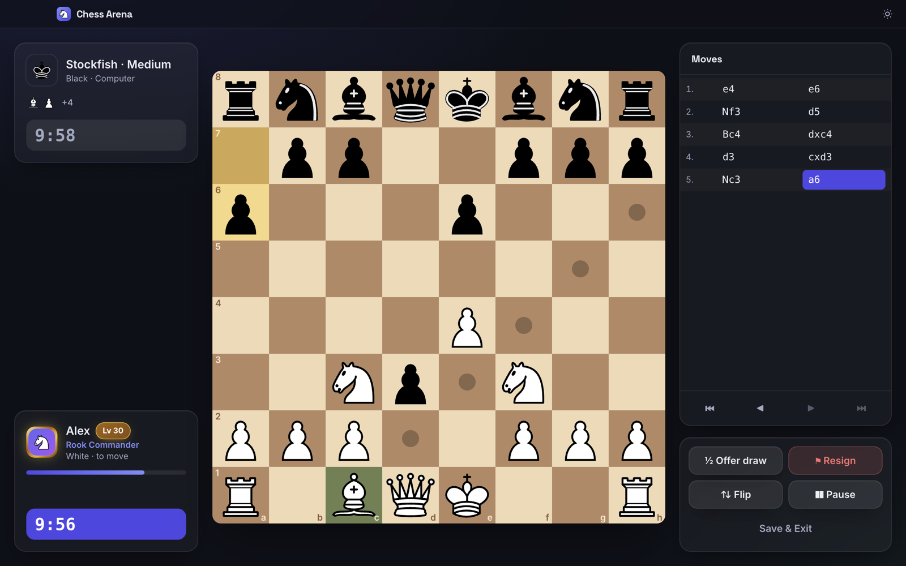
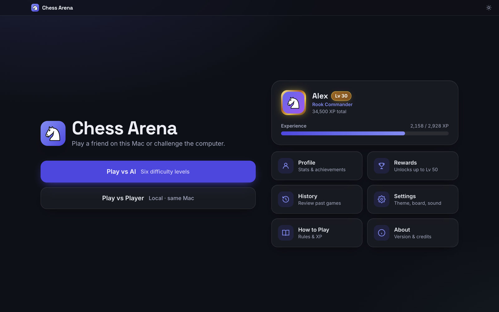
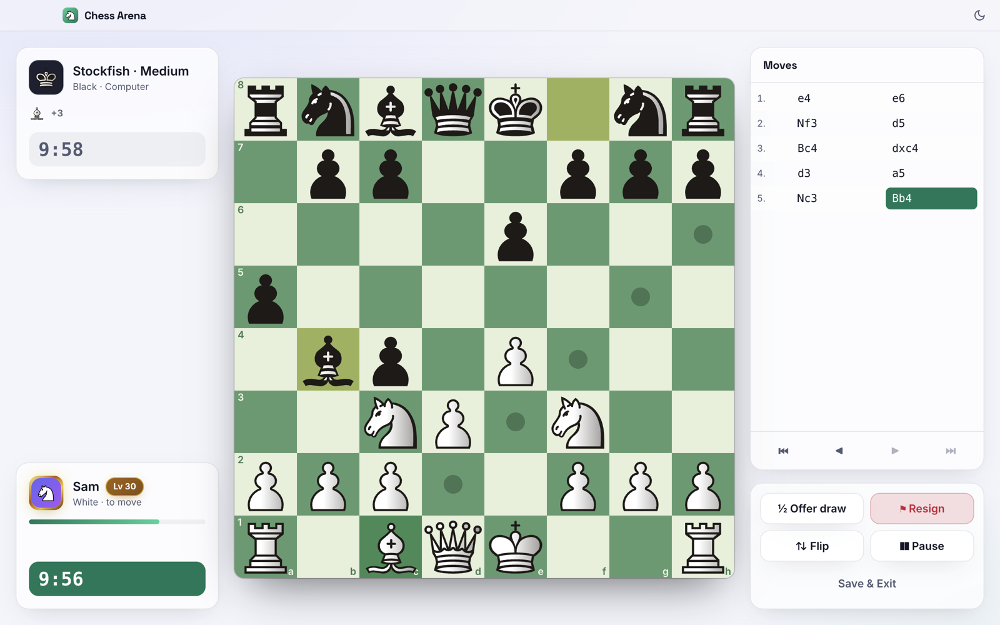
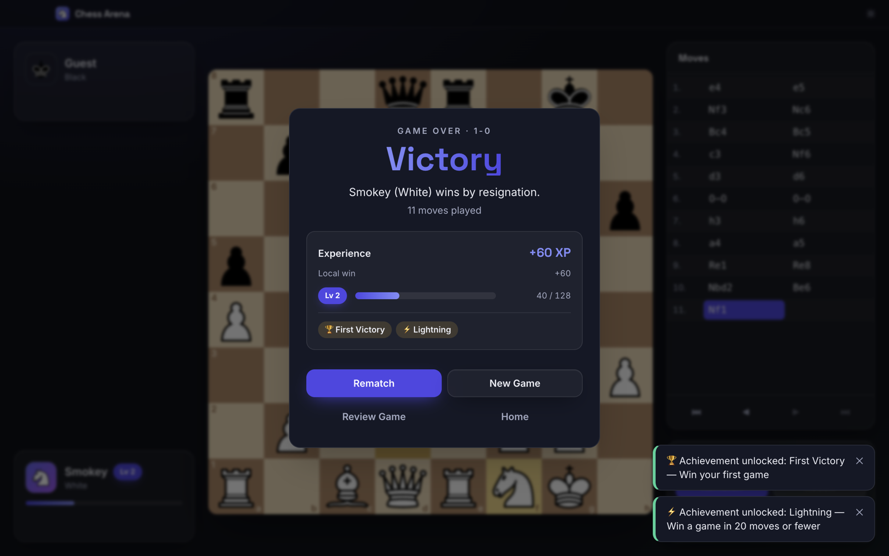
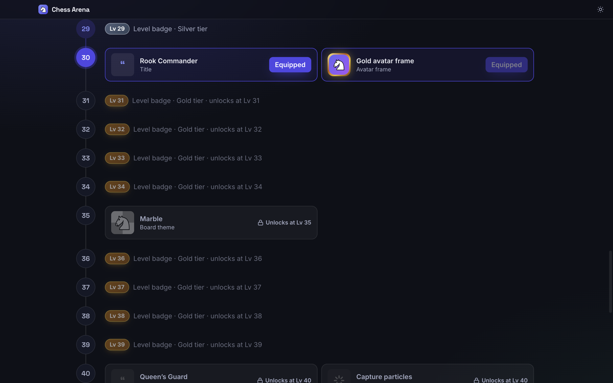
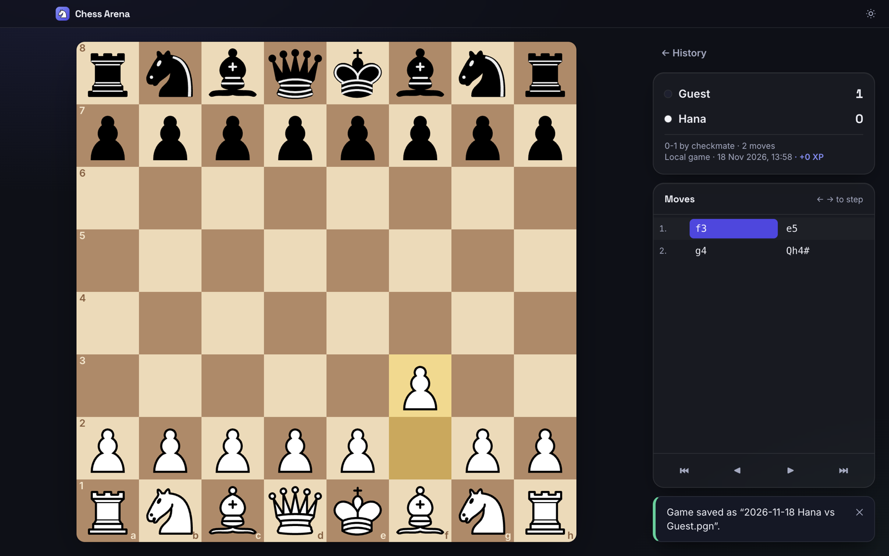
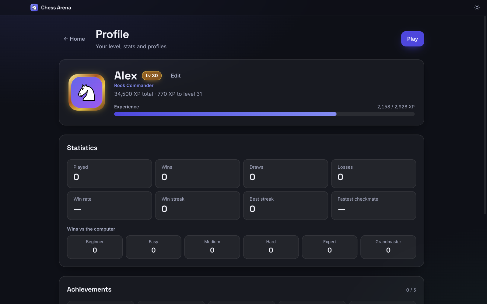

<div align="center">


# Chess Arena

**A modern chess game for Windows and macOS.**<br>
Challenge Stockfish at six difficulty levels, play a friend on the same computer or anyone online, and level up all the way to 50.

[](https://github.com/OCode3546/chess-arena/releases/latest)
[](https://github.com/OCode3546/chess-arena/releases)
[](https://github.com/OCode3546/chess-arena/actions/workflows/ci.yml)
[](#download)
[](LICENSE)

[**Download**](https://github.com/OCode3546/chess-arena/releases/latest) ·
[Features](#features) ·
[Screenshots](#screenshots) ·
[Install](#download) ·
[Build from source](#build-from-source) ·
[Roadmap](#roadmap)

<br>



</div>

<br>

## Features

- **Play the computer** — Stockfish 19 at six levels, from *Beginner* (beatable while learning) to *Grandmaster* (full strength). Optional hints and takebacks on the easier levels.
- **Play a friend** — pass-and-play on one computer with separate profiles, an auto-flipping board and fair XP rules.
- **Play online** — quick match against the next player looking for the same clock, or invite a friend with a 6-letter code. No account needed; the server runs the clocks and checks every move, and a dropped connection has 60 seconds to come back.
- **Real chess clocks** — Untimed, 3+2, 5+3, 10+0, 15+10 or a custom time control, with increments and pause.
- **Levels and rewards** — earn XP for every game, climb from level 1 to 50 and unlock 6 board themes, 2 piece sets, avatars, frames, titles and move effects.
- **Achievements and stats** — win streaks, wins per difficulty, fastest checkmate and more on your profile.
- **Game history** — step through every finished game move by move and export it as PGN for any chess program.
- **Never lose a game** — auto-saves after every move; quit any time and pick up exactly where you left off, clocks included.
- **Made for the desktop** — native look on Windows and macOS, dark and light themes, four accent colors, keyboard shortcuts and sound effects.
- **Works offline** — no account, no ads, no internet connection needed. Updates install themselves on Windows.

## Screenshots

<table>
  <tr>
    <td width="50%"></td>
    <td width="50%"></td>
  </tr>
  <tr>
    <td align="center"><sub><b>Home</b> — your profile, level and everything one click away</sub></td>
    <td align="center"><sub><b>Light theme</b> — Emerald board, legal moves shown as dots</sub></td>
  </tr>
  <tr>
    <td width="50%"></td>
    <td width="50%"></td>
  </tr>
  <tr>
    <td align="center"><sub><b>Game over</b> — XP breakdown, level-ups and achievements</sub></td>
    <td align="center"><sub><b>Rewards</b> — a roadmap of unlocks from level 1 to 50</sub></td>
  </tr>
  <tr>
    <td width="50%"></td>
    <td width="50%"></td>
  </tr>
  <tr>
    <td align="center"><sub><b>Review</b> — replay any finished game and export PGN</sub></td>
    <td align="center"><sub><b>Profile</b> — stats, streaks and achievements</sub></td>
  </tr>
</table>

## Download

Get the latest version from the **[Releases page](https://github.com/OCode3546/chess-arena/releases/latest)**.

| Your computer | File to download |
|---|---|
| Windows 10 or 11 (64-bit) | `ChessArena-Setup-x.y.z.exe` — installer, updates itself |
| | `ChessArena-x.y.z-portable.exe` — runs without installing |
| Mac with Apple Silicon (M1 or newer) | `ChessArena-x.y.z-arm64.dmg` |
| Mac with Intel processor | `ChessArena-x.y.z-x64.dmg` |

> [!NOTE]
> Chess Arena is not code-signed yet, so Windows and macOS show a one-time warning the first time you open it. The steps below show how to get past it.

<details>
<summary><b>Install on Windows</b></summary>

1. Run `ChessArena-Setup-x.y.z.exe`.
2. If Windows shows **"Windows protected your PC"**, click **More info → Run anyway**. You only need to do this once.
3. Choose where to install. Shortcuts are added to the desktop and the Start menu.

**Uninstall:** Settings → Apps → Installed apps → Chess Arena → Uninstall. Your profiles and games stay in `%APPDATA%\Chess Arena` unless you delete that folder.

</details>

<details>
<summary><b>Install on macOS</b> (12 Monterey or newer)</summary>

1. Open the `.dmg` and drag **Chess Arena** into **Applications**.
2. Open Chess Arena. macOS says it can't verify the app — click **Done**.
3. Open **System Settings → Privacy & Security**, scroll down to the message about Chess Arena, click **Open Anyway** and confirm. You only need to do this once.

Not sure which Mac you have? Apple menu → **About This Mac**: "Chip: Apple M…" means Apple Silicon, "Processor: Intel" means Intel.

If macOS says the app "is damaged", run this once in Terminal and open it again:

```sh
xattr -dr com.apple.quarantine "/Applications/Chess Arena.app"
```

**Uninstall:** drag Chess Arena from Applications to the Trash. Your profiles and games stay in `~/Library/Application Support/Chess Arena` unless you delete that folder.

</details>

<details>
<summary><b>Updates and system requirements</b></summary>

- **Windows installer:** new versions download in the background and install when you restart the app (Settings → App → *Update automatically*).
- **Mac and the portable exe:** the app tells you when a new version is out and opens the download page.

**Requirements:** Windows 10/11 (64-bit) or macOS 12+, 4 GB RAM, about 400 MB of disk space. No internet connection needed except for online games.

</details>

## Roadmap

- [x] Local play, AI opponent, clocks and auto-save
- [x] Profiles, XP, levels 1–50, rewards and achievements
- [x] Game history, review and PGN export
- [x] Windows and macOS installers with automatic updates
- [x] Online play — invite a friend with a 6-letter code, or get matched with a random opponent
- [ ] Code-signed builds (no first-launch warnings)
- [ ] Linux build

The full plan is in [`spec.md`](spec.md). Ideas and bug reports are welcome in [Issues](https://github.com/OCode3546/chess-arena/issues).

## Build from source

**Requirements:** [Node.js](https://nodejs.org/) 20 or newer and Git.

```sh
git clone https://github.com/OCode3546/chess-arena.git
cd chess-arena
npm install
npm run fetch:engine   # downloads the pinned, checksum-verified Stockfish for your OS
npm run dev            # starts the app with hot reload
```

| Command | What it does |
|---|---|
| `npm run dev` | Start the app in development mode |
| `npm test` | Unit tests (Vitest) |
| `npm run lint` · `npm run typecheck` | ESLint and TypeScript checks |
| `npm run verify:sandbox` | End-to-end smoke suite: builds the app against a local game server, plays through every screen, and has two app instances play online (invite code, quick match, quit and rejoin). Needs `npm ci --prefix server` once. Set `SMOKE_APP=<packaged executable>` to test a packaged build (online checks are skipped there) |
| `npm run dist:mac` | Build the Mac `.dmg` and `.zip` (Apple Silicon and Intel) into `release/<version>/` |
| `npm run dist:win` | Build the Windows installer and portable exe (run on Windows) |
| `npm run screenshots` | Regenerate the README screenshots (macOS) |

### Built with

[Electron](https://www.electronjs.org/) · [React](https://react.dev/) · [TypeScript](https://www.typescriptlang.org/) · [Vite](https://vite.dev/) via [electron-vite](https://electron-vite.org/) · [Tailwind CSS](https://tailwindcss.com/) · [Framer Motion](https://motion.dev/) · [Zustand](https://zustand.docs.pmnd.rs/) · [chess.js](https://github.com/jhlywa/chess.js) · [Stockfish](https://stockfishchess.org/) · [electron-builder](https://www.electron.build/)

### Project layout

```text
electron/      main process: window, storage, Stockfish process, auto-updater
src/           React renderer: screens, board, AI, progression, stores
src/shared/    types, IPC channels, validators and the online protocol (shared with the server)
src/net/       online play: WebSocket connection, reconnects, online game state
server/        the online game server (see server/README.md)
scripts/       Stockfish download, end-to-end smoke suite, screenshots
tests/         unit tests
docs/          README screenshots
```

<details>
<summary><b>Releasing a new version</b> (maintainers)</summary>

1. Bump `version` in `package.json` and add the notes to `CHANGELOG.md` and `src/config/changelog.ts`.
2. Commit, then tag and push: `git tag v1.0.0 && git push origin main v1.0.0`.
3. The **Release** workflow builds both platforms, runs the online end-to-end tests and the smoke suite against the packaged apps, and creates a **draft** GitHub Release with all files.
4. Check the draft and click **Publish release**. Installed apps only see the update after that.

**Code signing (optional).** Add these repository secrets and the release workflow uses them automatically:

- **Windows:** `WIN_CSC_LINK` (base64 `.pfx` or URL) and `WIN_CSC_KEY_PASSWORD`. An OV/EV certificate or Azure Trusted Signing removes SmartScreen warnings.
- **macOS:** `MAC_CSC_LINK` and `MAC_CSC_KEY_PASSWORD` (a *Developer ID Application* certificate from the Apple Developer Program), plus `APPLE_ID`, `APPLE_APP_SPECIFIC_PASSWORD` and `APPLE_TEAM_ID` for notarization. Signed Mac builds also update themselves.

</details>

## Contributing

Bug reports and suggestions are very welcome — please [open an issue](https://github.com/OCode3546/chess-arena/issues). For code changes, open a pull request and make sure `npm run lint`, `npm run typecheck` and `npm test` pass.

## License

Chess Arena is free software, released under the [GNU General Public License v3.0](LICENSE). You may use, study, share and modify it; versions you distribute must stay under the same license with their source code available.

### Credits

Chess Arena bundles [Stockfish](https://stockfishchess.org/) (GPL-3.0, [source](https://github.com/official-stockfish/Stockfish)), [chess.js](https://github.com/jhlywa/chess.js) (BSD-2-Clause), the Cburnett and Merida piece sets (GPL-2.0+), and the Inter and Space Grotesk fonts (OFL-1.1). See [CREDITS.md](CREDITS.md) and the [LICENSES](LICENSES/) folder — the license texts are also viewable in the app under **About**.

<div align="center">
<br>
<sub>Made by <a href="https://github.com/OCode3546">Orville Arrindell</a></sub>
</div>
